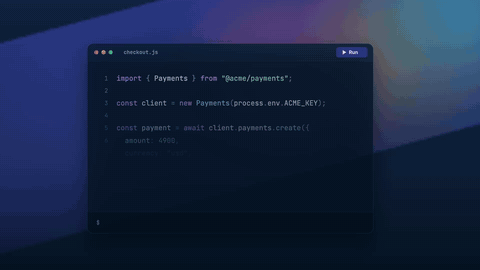
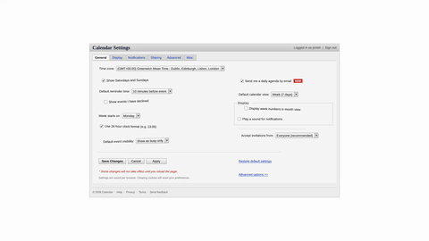
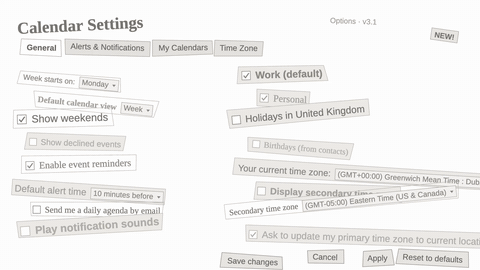

# blank-page

A skill for Claude Code and Codex, `blank-page`, for getting started on a motion piece. The hardest
part of prompting is the blank page: you know roughly what the clip is for, not what it
should look like. Give it a one-liner and it turns that into a full prompt with a look,
references and a sequence of beats, so the first result is already an interesting one.

Good for when you don't know what you want yet, and for when you do but want to explore
directions you wouldn't have thought of.

By [Stewdio](https://www.stewdio.ai), where you create motion graphics with prompts and
refine them by hand in a visual editor. The before / after clips below were made there.
The skill works with any agent, and pairs well with the
[Stewdio plugin](https://github.com/StewdioAI/plugin), which takes the expanded prompt
straight to an editable comp.

Made by Blake Shao ([@blak3shao](https://x.com/blak3shao)).

## Before / after

Each pair starts from the same one-line prompt. Before: the prompt handed to the agent
as typed. After: the prompt run through `/blank-page` first.

> 5 sec clip for a payments api: a request leaves the code and comes back as a payment confirmed. dark mode, kind of like stripe’s style

| before | after |
|---|---|
|  |  |

> quick 5 second twitter post: our design tool just hit 10,000 users

| before | after |
|---|---|
|  |  |

> 5s looping background for a saas pricing page. it sits behind the plan cards so keep it subtle. soft frosted glass, like apple’s website

| before | after |
|---|---|
|  |  |

> 5 second clip for a note-taking app launch. you type one search and results pop in from docs, slack and email

| before | after |
|---|---|
|  |  |

> 5 second changelog clip for a calendar app. the messy old settings page snaps into clean grouped sections. clean and minimal, lots of white

| before | after |
|---|---|
|  |  |

## Install

```sh
npx skills add StewdioAI/blank-page
```

Works with Claude Code, Codex and most other coding agents; it asks which ones to
install to. Add `-g` to install for every project instead of just this one.

## How to use

Type `/blank-page` (or `$blank-page` in Codex) and describe the clip the way you'd say it
out loud:

```
/blank-page a 5 second launch video for my app
```

That's enough to start. Add what it's for, a vibe, or a brand you like if you have one:

```
/blank-page 5 second clip for my coffee shop's new menu, warm and cozy
```

You can also just say "expand this prompt" or "help me write the prompt for ..." and it
kicks in.

## How it works

A one-line prompt gives the agent nothing to aim at, so it falls back on the safest
version of the idea. Instead of asking you to fill in the blanks, the skill goes looking
for references first and builds the prompt around what it finds.

1. **Pick a look.** Five images from one aesthetic on are.na, pinterest, or open internet. If you name a style or
   brand, it stays inside it.
2. **Find the motion.** Three gifs or videos with moves to reference.
3. **Write the beats.** A numbered sequence built from those references, with at least
   one twist: a reveal, a morph, a zoom-out.
4. **Add real assets.** A 3D model, footage or the real UI instead of a hand-built
   stand-in.

You get back the prompt with every reference attached, plus up to three creative
calls it made, so you can swap any of them before handing it to an agent.

Short edit notes ("make it faster") skip the search and come back as a short, precise note.
More examples: [`references/examples.md`](skills/blank-page/references/examples.md).

## Layout

```
skills/blank-page/
  SKILL.md             the procedure
  agents/openai.yaml   Codex display metadata
  references/          finding-references, vocabulary, examples, patterns
  scripts/find_refs.py are.na / Pinterest / Sketchfab search, downloads, contact sheets
media/                 before / after gifs for the README
```

## Requirements

- `python3` (stdlib only) and `curl`
- `ffmpeg` for contact sheets (`find_refs.py sheet`, `channel <slug> <dir>`)
- web search in the agent, for finding Pinterest pins
- optional `SKETCHFAB_TOKEN` for Sketchfab downloads not in the Objaverse mirror

## License

[MIT](LICENSE)
